# Tigrinho Simulator

Jogo 2D em Python/Pygame que **critica as apostas e denuncia o dano que elas podem causar**.
Você é um pai endividado com um agiota, com um celular cheio de apps de aposta.
**Para vencer, passe 7 dias seguidos sem apostar.** Se o saldo zerar, você perde a família.

> Trabalho da disciplina de Programação Orientada a Objetos — Universidade Federal de Minas Gerais, 2026.
> Autores: Arthur Lobo Nunes Verçosa, Davi Menezes dos Santos, Renato Alexandre Moura Pinheiro, Yan Martelleto

## Sumário
- [Como jogar](#como-jogar)
- [Instalação e execução](#instalação-e-execução)
- [Controles](#controles)
- [Estrutura do projeto](#estrutura-do-projeto)
- [Conceitos de POO aplicados](#conceitos-de-poo-aplicados)
- [Banco de dados](#banco-de-dados)
- [Documentação](#documentação)
- [Imagens do jogo](#imagens-do-jogo)

## Como jogar
- Comece com **R$ 5.000** e vá para a casa, a rua e o celular.
- No celular há três jogos de aposta — **Roleta europeia**, **Blackjack** e **Tigrinho** (caça-níquel) —,
  o app **Runs** (histórico de partidas) e o **iFood**.
- Limite de **10 apostas por dia**; ao atingi-lo o dia termina.
- **iFood** rende R$ 500 e encerra o dia sem apostar (a saída honesta).
- **Vitória:** 7 dias consecutivos sem apostar. **Derrota:** saldo zerado.

## Instalação e execução

Requisitos: Python 3.13.15 ou compatível e Pygame.

### 1. Baixar o projeto

Abra o terminal (PowerShell, Prompt de Comando ou terminal do VS Code) e execute:

```bash
git clone https://github.com/davimenezes470-pixel/TP-POO-2026-2.git
cd TP-POO-2026-2
```

### 2. Instalar o Pygame

Com o Python instalado, execute no terminal:

```bash
py -m pip install pygame
```

Para conferir se a instalação funcionou:

```bash
py -c "import pygame; print(pygame.version.ver)"
```

Se o comando `py` não funcionar no seu computador, tente usar `python` no lugar dele.

O jogo abre em 1280×720 (60 FPS). Também pode ser empacotado em executável com o
PyInstaller usando o arquivo `TigrinhoRPG.spec`.

## Controles
| Tecla | Ação |
|---|---|
| ← / → | Andar |
| E | Conversar com a esposa/filha |
| C | Abrir o celular |
| F | Entrar/sair de casa |
| Enter / Espaço | Confirmar |
| Esc | Voltar |
| F11 | Tela cheia |
| T | Modo de teste (força o resultado nos jogos) |

## Estrutura do projeto
```
assets/          imagens e spritesheets
docs/            documentação (relatório e diagramas UML)
src/
  core/          StateManager, Tracker (banco de dados)
  modelos/       regras dos jogos e entidades (sem Pygame nas regras)
  states/        uma classe por tela
  utils/         HUD
  config.py      constantes e caminhos
  game.py        classe Game (loop principal)
  main.py        ponto de entrada
```
As regras (`modelos/`) ficam separadas da interface (`states/`), então podem ser
testadas sem abrir janela.

## Conceitos de POO aplicados
| Conceito | Onde |
|---|---|
| Classe abstrata | `Aposta`, `BaseState` (`ABC`) |
| Herança | `Aposta` → `ApostaNumero`/`ApostaCor`/`ApostaParidade`; `BaseState` → 12 telas; `Sprite` → `Player`/`Esposa`/`Filha` |
| Polimorfismo | `aposta.resultado()`, `estado.draw()`, `update()` dos sprites |
| Encapsulamento / getters e setters | `Carteira.saldo`, propriedades do `Tracker` |
| Composição / agregação | `Game` → `StateManager`/`Tracker`/`Player`; `Carteira` compartilhada pelas mesas |
| Injeção de dependência | `rng` injetável em `Roleta`, `Baralho` e `Rolos` |
| Padrão State | `StateManager` + `BaseState` |
| Tratamento de erros | `ValueError` nas regras, capturado nas telas |

## Banco de dados
O histórico de partidas é salvo em JSON pela classe `Tracker` (`runs_data.json`):
ganhos, perdas, dias jogados e jogadas por minigame. Se o arquivo não existir ou
estiver corrompido, o jogo começa com histórico vazio.

## Documentação
- Relatório em formato IEEE: `docs/RelatórioTP-POO-Grupo6.pdf`
- Diagramas UML: `docs/`

## Imagens do jogo

As capturas de tela abaixo estão na pasta `docs/` do repositório.

| Tela | Captura de tela |
|---|---|
| Tela inicial | 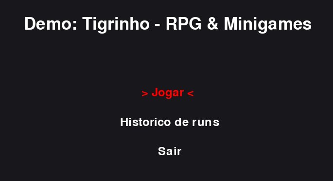 |
| Casa — área externa | 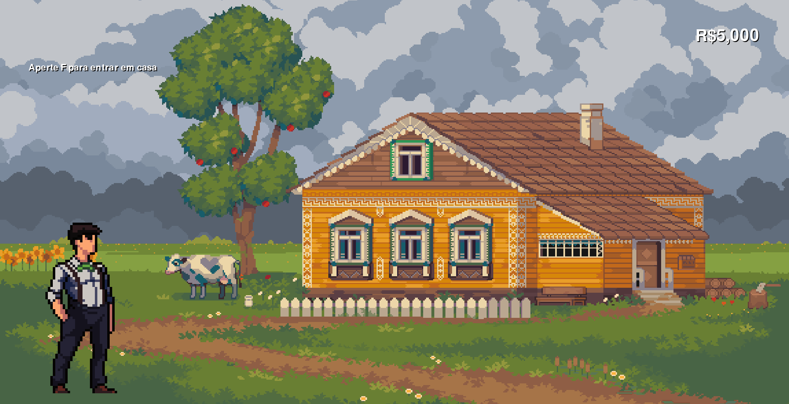 |
| Casa — área interna | 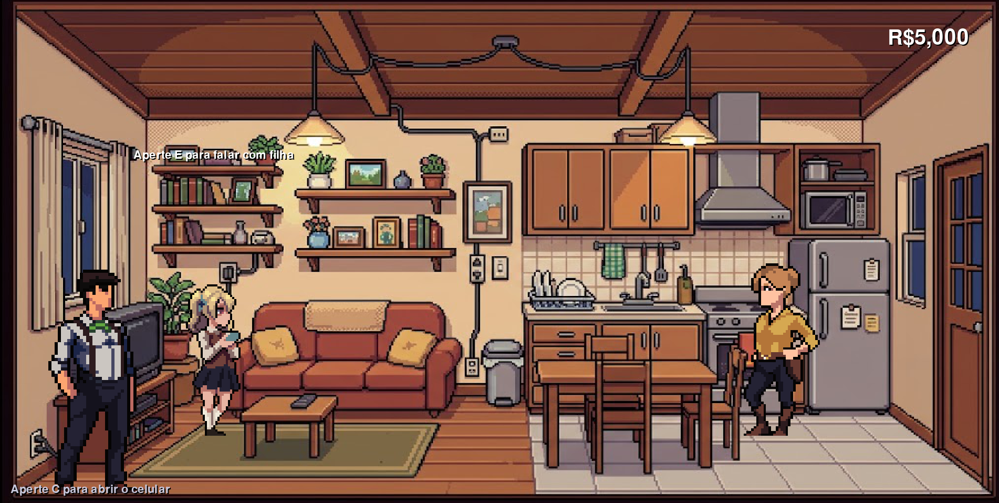 |
| Conversa com a esposa | 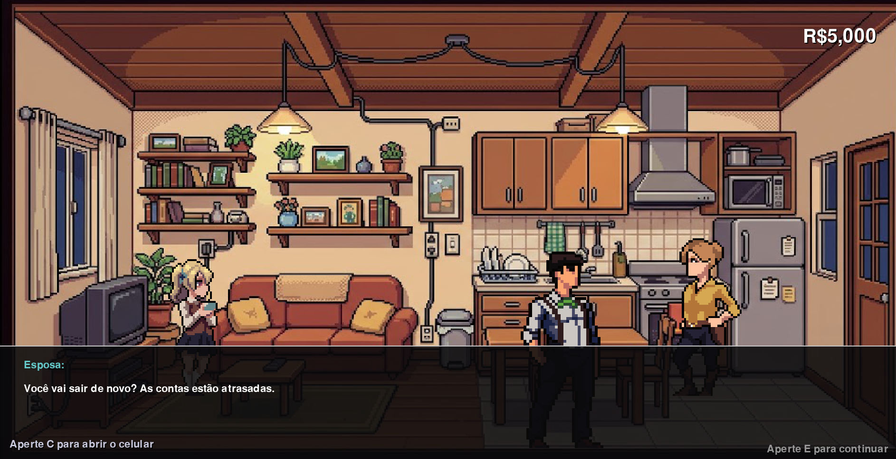 |
| Conversa com a filha | 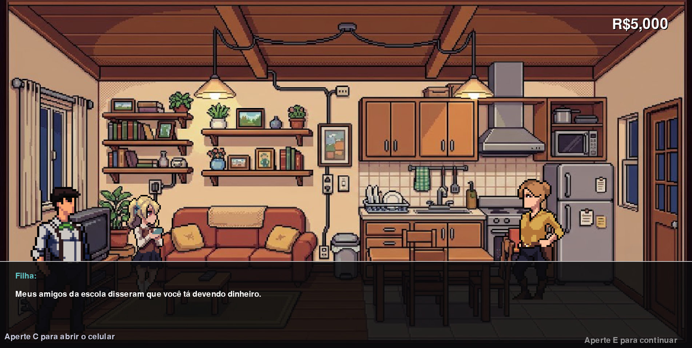 |
| Conversa com o agiota | 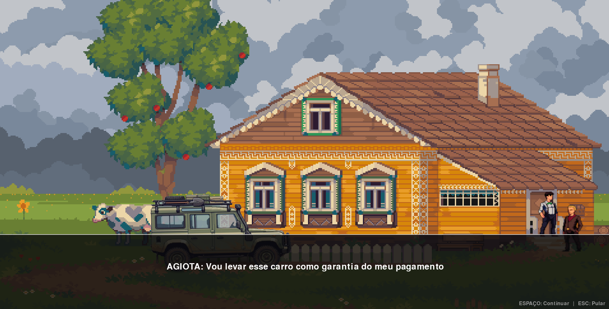 |
| Celular | 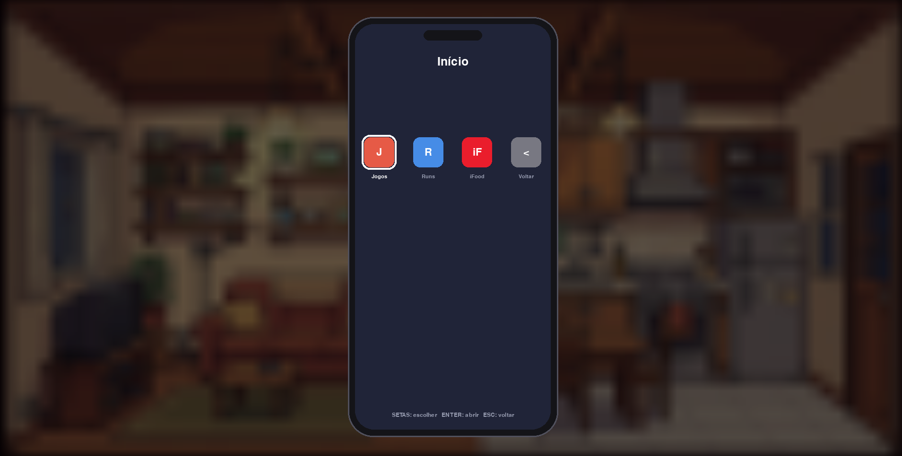 |
| Jogos disponíveis no celular | 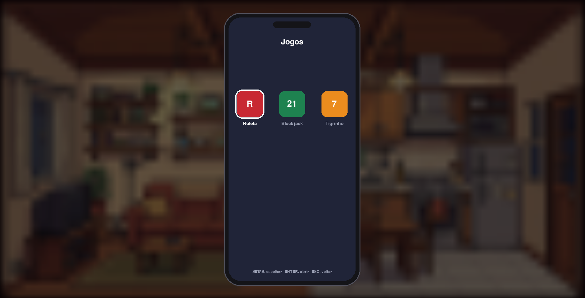 |
| Roleta | 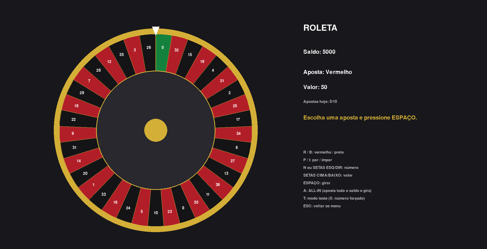 |
| Blackjack | 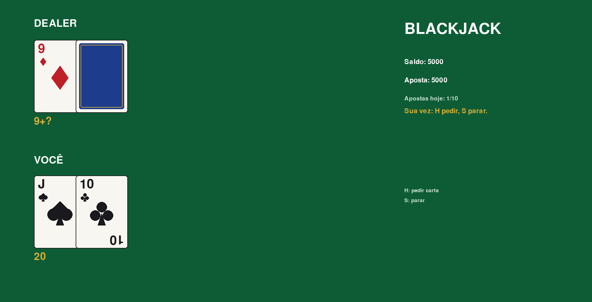 |
| Tigrinho | 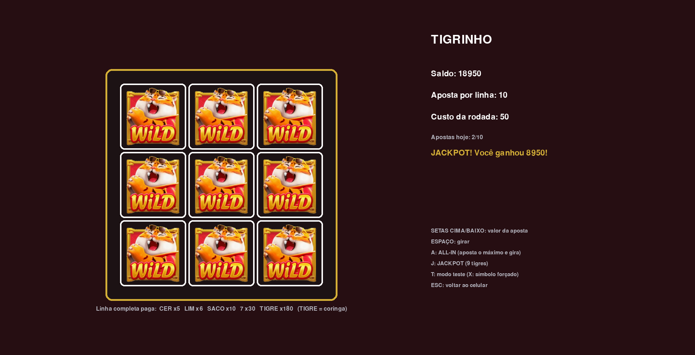 |
| Passagem de dia | 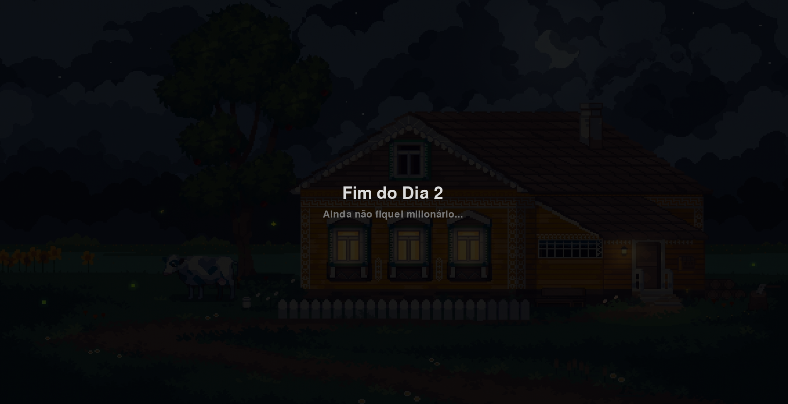 |
| Game over | 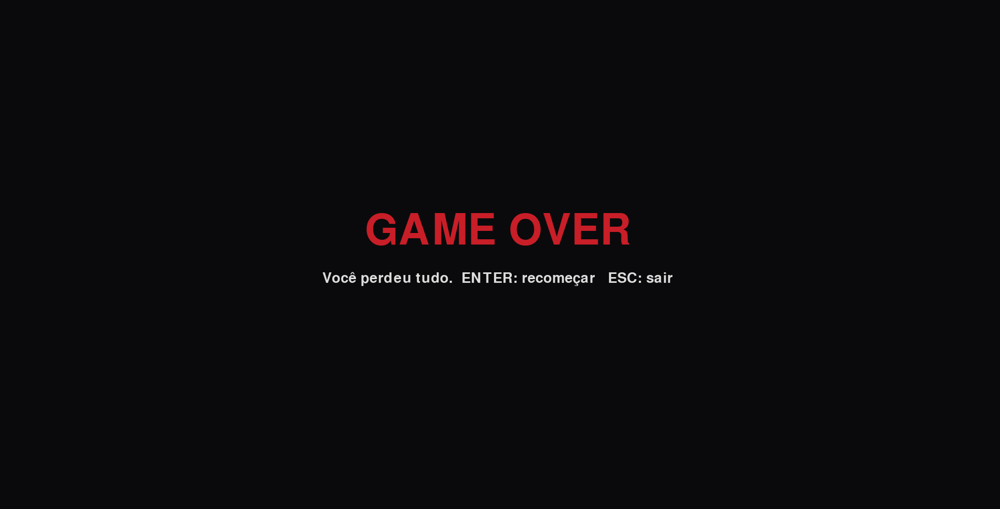 |
| Vitória | 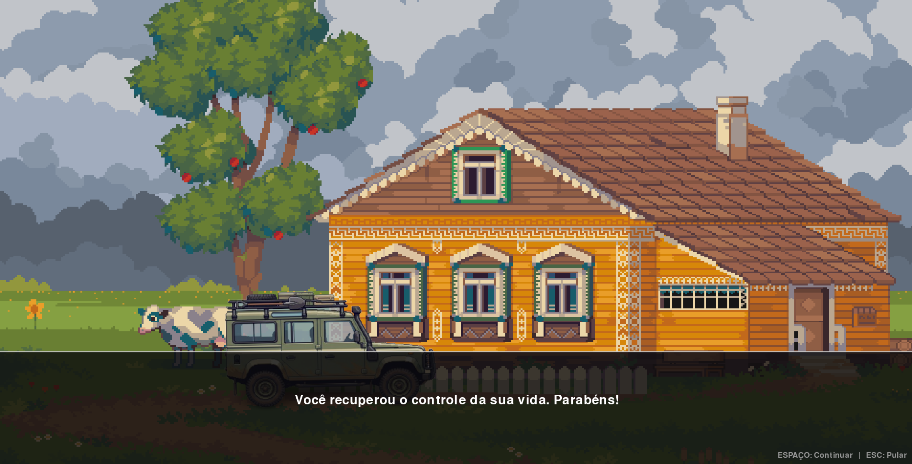 |
